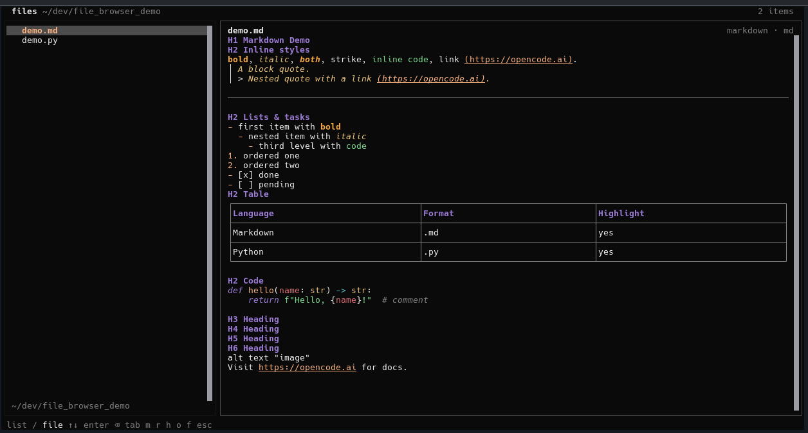

# OpenCode File Browser

TUI plugin for OpenCode V2: an explorer, a viewer, an editor and a small git
panel, all inside the terminal.

**Status:** v1.0.0 · OpenCode 2.2.x · MIT

| Where | Link |
|---|---|
| Code/releases | <https://github.com/arthurrogado/opencode-file-browser> |
| npm | <https://www.npmjs.com/package/opencode-file-browser> |
| Wiki (install/update) | [howto-opencode-file-browser-plugin](https://github.com/arthurrogado/tecnico_ti/blob/main/wiki/pages/howto-opencode-file-browser-plugin.md) |



## Install

```sh
opencode plugin add opencode-file-browser@1.0.0
```

The plugin is registered in `~/.config/opencode/cli.json`. For local
development point the entry at a checkout instead:

```jsonc
{ "plugins": ["/absolute/path/to/opencode-file-browser"] }
```

Restart the TUI (or `/reload`) after installing.

## What it does

**Explorer**

- Project tree with folders that expand in place, hidden-file toggle and a
  configurable start state (`collapsed` or the whole tree expanded).
- Search box above the list: `Ctrl+E` switches between **name/path** search and
  **content** search. Content search uses `git grep --untracked` (falls back to
  `grep`), caps results per file and opens the hit at its line. `Case sensitive`
  is a preference.
- Folders either expand in place (**expand**) or replace the listing like a
  file manager (**navigate**), configurable in `F2`.
- Right click (or `F10`) opens item actions: new file, new folder, rename,
  delete, close this/other/all tabs.
- Status line with the current branch and change count.

**Viewer and editor**

- Rendered Markdown (`m` toggles the source), tree-sitter highlighting and a
  line-number gutter for everything else.
- Real editing through the host's textarea: cursor, selection, undo/redo,
  `Enter` inserts a line, `Ctrl+F` finds inside the file, syntax colours come
  from extmarks while editing, and a one-column scrollbar shows the position.
  Clicking the text moves the cursor. `Ctrl+S` saves; files changed on disk
  need an explicit overwrite confirmation.
- Tabs for every open document (`Ctrl+W` closes, `Ctrl+←/→` switches, the `×`
  and a middle click also close). Dirty tabs are marked with `●`, and open tabs
  survive a trip to the chat (state lives in the host memory store).
- Large files open read-only instead of freezing the TUI (see limits).
- Markdown opens as a rendered preview; `e`/`F4` switches between preview and
  source.

**Changes (git)**

- Stage, unstage, discard, commit, pull, push, list branches and recent
  commits, from the panel on the right. `Ctrl+G`/`F3` focuses it, `c` opens the
  commit message box and `Ctrl+Enter` commits.
- `Enter` on a change opens its unified diff; `F4` jumps to the real file.
- Destructive actions ask for confirmation when `Confirm discard` is on.

**Preferences**

- `F2` opens the preferences modal (also in the command palette as
  *File browser: preferences*). Everything is persisted by the host and applies
  to every session.
- **Simple mode** keeps only the classic list + preview browser.

## Keyboard

| Key | Action |
|---|---|
| `Ctrl+X F` | open/close the browser |
| `Ctrl+X O` | open a file by path (`~`, absolute or relative) |
| `F1` | every shortcut |
| `F2` | preferences |
| `F3` / `Ctrl+G` | focus the changes panel |
| `F4` / `e` | toggle preview/editor |
| `F5` | reload tree, file and git status |
| `F10` | item actions (same menu as right click) |
| `Shift+Tab` | focus the explorer |
| `↑ ↓` or `j k` | move in the list |
| `→` / `Enter` | open file or expand folder |
| `←` | collapse folder |
| `Shift+Enter` | collapse the whole tree |
| `Tab` | cycle explorer → editor → changes |
| `Ctrl+F` or `/` | focus the search box |
| `Ctrl+E` | switch name/content search |
| `Ctrl+S` | save |
| `Ctrl+W` | close tab |
| `Ctrl+←` / `Ctrl+→` | previous/next tab |
| `Enter` (editing) | new line |
| `Ctrl+F` (editing) | find inside the file |
| `m` | Markdown preview/source |
| `r` | reload tree, file and git status |
| `h` | toggle hidden files |
| `f` | fullscreen (docked panel) |
| `Esc` | leave editor → clear search → close |
| `a u d` | stage / unstage / discard (changes panel) |
| `c l p` | commit / pull / push (changes panel) |
| `g b` | history / branches (changes panel) |

Mouse: click to open, click tabs to switch, middle click to close a tab, wheel
to scroll, drag the divider to resize the explorer.

## Preferences

`F2`, or the palette command *File browser: preferences*.

| Option | Default | Notes |
|---|---|---|
| Simple mode | off | list + preview only |
| Line numbers | on | gutter in viewer and editor |
| Wrap lines | off | wrap while editing (hides the gutter) |
| Folders | expand | `expand` in place or `navigate` into the folder |
| Panel preview | on | preview inside the docked session panel |
| Changes panel | on | hidden below 130 columns |
| Hidden files | off | show dotfiles |
| Mouse | on | click, scroll, drag |
| Search | name | default search target |
| Case sensitive | off | match case in file and content search |
| Confirm discard | on | confirm closing dirty files / discarding changes |

## Limits

- Viewer: the first 2 000 lines are rendered (files are clipped at 4 000 chars
  per line). Above 20 000 lines or 2 MiB the plugin shows a metadata placeholder
  instead of the buffer, so a huge log cannot starve the TUI event loop.
- Editing: read-only above 5 000 lines or 512 KiB.
- Content search: 12 hits per file, 300 total.
- Binary files are reported, never rendered.

## Development

```sh
npm install
npm run typecheck
npm run bundle      # src/**/*.tsx -> dist/**/*.js (Solid transform)
./test/e2e.sh       # drives a real TUI in tmux against a git fixture
```

`dist/` is committed because the host loads the pre-compiled entrypoint.
